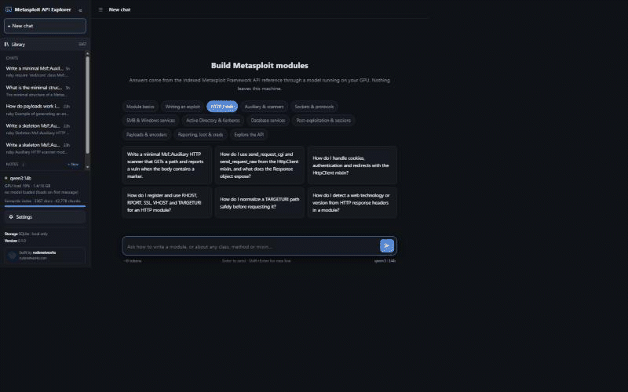
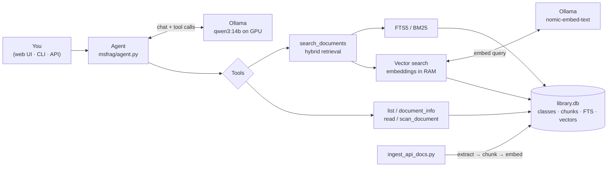

<div align="center">


# Metasploit API Explorer

**A fully local AI guide to the Metasploit Framework API: ask how to write a module, or about any class, method or mixin, and get grounded answers with runnable Ruby examples. Your GPU, your machine, nothing leaves it.**


-black)

Built by **[rudenetworks](https://rudenetworks.com)** · same design as CVE Explorer, Document Explorer and Files Explorer

</div>

<p align="center"></p>

<p align="center"><a href="docs/demo.mp4">▶ Watch the full demo (28s, MP4)</a> — chapter showcase · streaming Ruby module · clickable API citations · the 3,367-class library</p>

Metasploit API Explorer indexes the official Metasploit Framework **API reference** (the YARD docs at
`docs.metasploit.com/api/` — one page per Ruby class, module and mixin) into a local catalog, and lets a chat
agent answer questions about it in plain language: *"how do I use `send_request_cgi`?"*, *"which mixins should a
remote HTTP exploit include?"*, *"write a skeleton auxiliary scanner that reports a vuln"*, *"how do I register
and read datastore options?"*. A local LLM in [Ollama](https://ollama.com) answers with **runnable Ruby code
examples** and clickable citations like `[D12]` back to the exact reference page it used.

It is a specialization of the same engine as the other *Explorer* apps: the document library is the scraped API
reference, each "document" is one class/module/mixin page, and `collection` is the top-level namespace
(`Msf`, `Rex`, `Msf::Exploit`, …).

---

## What it does

- **Grounded module-writing help.** The agent is primed to follow Metasploit conventions — correct superclass,
  `include` of the right `Msf::Exploit::Remote::*` mixins, `initialize`/`super(update_info(...))`,
  `register_options`, and the right entry method (`exploit`, `run`, `check`, `run_host`) — and to use only
  methods and options it has confirmed in the reference, naming the page each came from.
- **Hybrid retrieval.** SQLite FTS5/BM25 keyword search + `nomic-embed-text` embeddings, merged with reciprocal
  rank fusion, over every passage of every class page.
- **Agent tools** (tool calling on a local model, default `qwen3:14b`): `search_documents`, `list_documents`,
  `document_info` (a class's method outline), `read_document` (read a class in order), `scan_document` (read a
  whole large class for one question).
- **Same web app, CLI and API** as the rest of the family: streaming answers with expandable tool steps, chat
  history, notes you can carry between chats, a context meter with *Summarize & continue*, themes
  (System / Light / Dark / Hack), model switching/downloading, live GPU/VRAM status, and an API-key-protected
  `/api/v1`.

## Quick start

```bash
# 1) create the environment
python -m venv .venv
.venv\Scripts\pip install -r requirements.txt     # Windows (bash: .venv/bin/pip)

# 2) make sure Ollama is running and the models are pulled
ollama pull qwen3:14b
ollama pull nomic-embed-text
.venv\Scripts\python -m msfrag doctor             # checks library, Ollama, models, GPU

# 3) scrape the Metasploit API reference to Markdown (~3,369 pages; a few minutes)
.venv\Scripts\python scripts/scrape_api_docs.py          # -> metasploit-api-docs/

# 4) ingest it (per-namespace collections; skips unchanged files)
.venv\Scripts\python scripts/ingest_api_docs.py metasploit-api-docs --no-summary
#   drop --no-summary to also write a one-paragraph summary of every class (much slower)

# 5) run the web UI  ->  http://127.0.0.1:8120
.venv\Scripts\python -m msfrag web
```

The corpus in `metasploit-api-docs/` is a Markdown mirror of `https://docs.metasploit.com/api/` (one file per
class, laid out by namespace). It is **not** committed to the repo — regenerate it with
`scripts/scrape_api_docs.py`, then re-run `ingest_api_docs.py` to refresh the index.

## CLI

```
python -m msfrag doctor            # environment check
python -m msfrag add <path>        # index files/folders (markdown, text, code, pdf, docx, …)
python -m msfrag list              # list indexed pages
python -m msfrag search "<query>"  # retrieval only, no LLM
python -m msfrag ask "<question>"  # one-shot agent answer
python -m msfrag chat              # interactive agent session
python -m msfrag web --port 8120   # web UI + API
```

## How it works



Everything lives in `library.db` (the indexed reference), `chats.db` (chats, notes, API keys) and
`settings.json`. All inference is local through Ollama; nothing is sent anywhere.

## Notes & safety

For authorized security work: Metasploit modules are offensive-security tooling, so use what you build only
against systems you own or are explicitly authorized to test. The agent answers from the indexed API reference
and clearly labels anything it adds from general knowledge.

---

<div align="center"><sub>Built by <a href="https://rudenetworks.com">rudenetworks</a> · GPL-3.0</sub></div>
